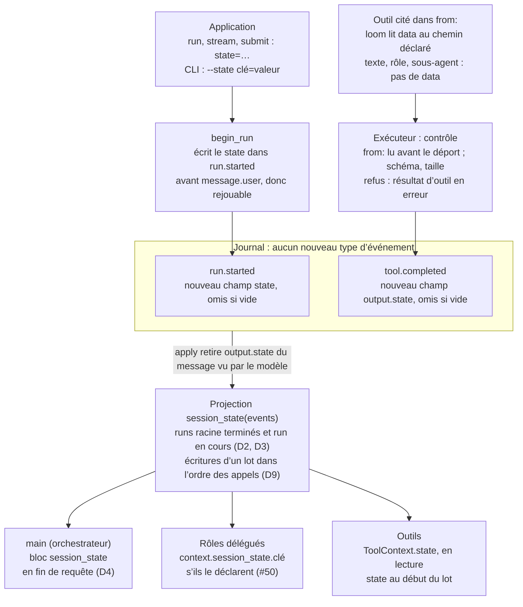

# Analyse d'impact — state de session loom_v2

14 octobre 2026 · Denis Lamard

## En bref

Le fond de `docs/state-et-context.md` est bon et à garder : un state **déclaré, typé, projeté du journal**, et un contexte de `main` **optionnel**. Mais, codée telle qu'écrite, la proposition casse cinq choses, dont trois démontrées sur une copie du dépôt.

| # | Ce qui casse | Preuve |
| --- | --- | --- |
| B1 | `state.set` en catégorie `tool` devient la « cause » du run : un outil terminal fait planter le run (`RuntimeError: sortie terminale sans tool.completed`) | Démontré |
| B2 | `ToolOutput.state` avec une valeur par défaut change le `request_hash` de toute requête qui contient un résultat d'outil : les 5 suites de non-régression j1 à j5 tombent | Démontré |
| B3 | Un nouveau type d'événement rend la **session entière** illisible pour loom 2.0.x (`JournalCorrupted`) : retour arrière et workers de versions mêlées cassés, ce que DEC-1 (2.0.5) venait de régler | Démontré |
| B4 | Le rejeu sert `tool.completed.output` : un state retiré de l'output et journalisé à part n'est pas reproduit, donc divergence dès que le state est injecté | Lu dans `replay/book.py` |
| B5 | L'« écriture atomique avec le tool.completed » n'existe pas : la boucle écrit un brouillon par `append` ; un plantage entre les deux laisse un state sans résultat | Lu dans `engine/loop.py` |

**Recommandation : option C.** Le state voyage dans des événements qui existent déjà — `ToolOutput.state` gardé dans `tool.completed`, et `run.started.state` pour l'application — sans nouveau type d'événement. Les cinq points tombent d'eux-mêmes, et le socle prototypé (4 fichiers, 11 lignes) garde **2 564 tests verts sur 2 564**, pyright `src` à 0 et les 5 contrats d'import. Les valeurs ne sont pas codées dans les outils : loom les lit dans leur résultat d'après une déclaration `from:`. Et le bloc va à la fin de chaque requête, après le point de cache, pour que le state fasse économiser des tokens au lieu d'en coûter.

Préalable : la CI qualité est **rouge sur `main`** depuis `4426b0d` (ruff et pyright sur `scripts/journal_html.py` et `Claude outputs/`). À remettre au vert avant de coder, sinon une régression de typage passera inaperçue. Un bug latent du même mécanisme que B1 est aussi à corriger d'abord (X10).

## Périmètre et état de référence

L'analyse porte sur le commit `4426b0d` (identique au poste, seul `.gitignore` diffère), version `2.0.6` non publiée. Rien n'a été écrit dans `/home/denis/dev/loom_v2` : tests et expériences ont tourné sur un clone, en Python 3.14.6 avec `uv sync --locked --all-extras`.

**Lu :** `docs/state-et-context.md`, `fonctions.md` (§12, §22, §23), `conception.md`, `CHANGELOG.md` (DEC-1 en 2.0.5), l'agent d'essai `examples/agents/agent_01` ; dans `src/loom_ia` : `core/events/*`, `core/projections/*`, `core/model/{content,run_state,streaming,policy}.py`, `core/ports/tool.py`, `engine/{loop,executor,roles,delegated,hooks}.py`, `agents/spec.py`, `runtime/wiring.py`, `guards/{judge,fidelity}.py`, `sessions/{snapshot,compaction}.py`, `replay/{book,runner,evals}.py`, `tools/{python,idempotent}.py`, `adapters/stores/codec.py`, `adapters/postgres/sql.py`, `access/{api.py,http/*,progress.py}`, `telemetry/{spans,trace}.py`, et les tests associés.

| Contrôle (avant toute modification) | Résultat |
| --- | --- |
| `pytest` (unitaires, régression, firecracker ; intégration sans services) | 2 564 passés, 169 sautés (Postgres, RabbitMQ, Redis absents) |
| `lint-imports` | 5 contrats tenus |
| `pyright` strict | **140 erreurs**, toutes dans `scripts/journal_html.py` |
| `ruff check` / `ruff format --check` | **30 erreurs** et 2 fichiers à reformater, dans `scripts/journal_html.py` et `Claude outputs/journal_html.py` |

Le job CI « Qualité » (ruff, pyright, import-linter) est donc rouge depuis `4426b0d`. Le même commit a aussi versé `docs/.~lock.fonctions.md#` (verrou LibreOffice) et le dossier `Claude outputs/` dans le dépôt.

## Les constats de la proposition, vérifiés

Sept constats sur onze tiennent ; quatre sont faux ou incomplets, et ce sont eux qui mènent aux points bloquants.

| Constat de la proposition | Verdict | Ce que dit le code |
| --- | --- | --- |
| §2.1 Le journal fait foi, tout le reste est projection | Juste | `core/projections/*` pures ; `drive` relit tout le journal (`loop.py` l. 486, et non ~497) |
| §2.2 La compaction ne supprime rien | Juste | `session.compacted` / `session.trimmed` sont des marqueurs ; un state recalculé sur tout le journal survit à la compaction et au trim |
| §2.3 Couches : modèle et projection dans `core`, injection dans `engine` | Juste | Contrats import-linter de `pyproject.toml` |
| §2.4 Un type d'événement inconnu fait échouer la lecture | Juste, mais la gravité est sous-estimée | C'est la **session entière** qui devient illisible, pas l'événement. Et le « précédent » `run.claimed` est antérieur à la publication PyPI et à DEC-1 : le commentaire de `DURABLE_PAYLOADS` (l. 1158) parle d'une liste tenue à la main qui les avait perdus, pas d'un ajout après coup |
| §2.5 Les événements `session` sont écartés des projections par run | Juste | `run_state.py` l. 437 et 452, `api.py` l. 737, `snapshot.py` l. 105, `tree.py` l. 37 |
| §2.6 `ToolContext` n'a pas accès au state | Juste | `core/ports/tool.py` ; précédent utile : le rappel `on_reuse` |
| §2.7 `_model_step` est le point d'injection | Juste | `loop.py` l. 1603-1627 : `system`, `messages`, puis `before_model` |
| §2.8 La mécanique de contexte des rôles se réutilise « telle quelle » | Incomplet | `ContextItem` existe **deux fois** (`agents/spec.py` et `engine/roles.py`, reliés par `wiring._context_item`) et sert aussi aux **juges** (`JudgeSpec.context`, `guards/judge.py`) ; `_check_template` refuse tout sous-chemin sauf `caller_context` ; `TAGS` et `described()` sont à compléter |
| §3.2 `state.set` en catégorie `tool` : aucun filtre à changer | **Faux** | `_effect` (l. 523) fait de tout événement `tool` la cause du run → B1. La docstring d'`IdempotencyRecorded` (l. 945) explique pourquoi il a sa propre catégorie |
| §3.2 Écrit dans le même lot atomique que le `tool.completed` | **Faux** | `_driven.write` (l. 625) ajoute un brouillon par `append` → B5 |
| §3.4 `ToolOutput.state` retiré avant journalisation : « anciens lecteurs inchangés » | **Faux** | Le champ change la sérialisation de chaque résultat d'outil dans les requêtes → B2 ; et le retirer du journal prive le rejeu et le cache d'idempotence du state → B4 |

## Points bloquants

Chacun de ces cinq points fait échouer un run, un rejeu ou une lecture de journal qui marchent aujourd'hui.

### B1 — La catégorie `tool` fait de `state.set` la cause du run

`_effect()` retient tout événement de catégorie `model` ou `tool` comme cause (`loop.py` l. 523-532) ; `write()` la met à jour à chaque écriture (l. 638) et une reprise la recalcule (l. 495). Pour un outil terminal, `_final` exige que la cause soit le `tool.completed` (`_terminal_event`, l. 1465). Un `state.set` écrit **après** ce résultat la remplace : le run lève `RuntimeError: sortie terminale sans tool.completed`. Avec une catégorie dédiée (`state`), le même scénario finit en `COMPLETED` — vérifié dans les deux ordres.

Ce mécanisme est déjà un **bug latent à HEAD**, sans aucun state : si le process meurt juste après le `tool.completed` d'un outil terminal et qu'une source MCP facultative est injoignable à la reprise, son `tool.source_unavailable` (catégorie `tool`) devient la cause et le run lève la même `RuntimeError` — à chaque reprise, puisque l'événement reste au journal. Vérifié (annexe, X10).

### B2 — `ToolOutput.state` change toutes les empreintes de requête

`request_hash()` hache `model_dump()` de toute la requête, résultats d'outils compris (`streaming.py` l. 66-79). Un champ `state = {}` ajoute `"state": {}` à chaque résultat : **j1, j2, j3, j4 et j5 divergent** au deuxième appel de modèle (« les messages »). Le correctif existe déjà dans le code pour `output_schema` (l. 72) : omettre le champ quand il est vide, ici `Field(exclude_if=lambda v: not v)`, disponible dès Pydantic 2.12.0 (borne basse du projet, vérifié). Avec lui, les 5 suites repassent.

### B3 — Un nouveau type d'événement casse le retour arrière

Un journal qui contient un `state.set`, relu par le loom actuel, lève `JournalCorrupted` sur la ligne (catégorie inconnue + tag inconnu de l'union) : **toute la session** devient illisible. Sont touchés le retour à une 2.0.x, les workers RabbitMQ de versions mêlées pendant une mise à jour, et tout journal exporté vers un loom plus ancien — exactement ce que DEC-1 a corrigé en 2.0.5 (« retour arrière, workers de versions mêlées »). À l'inverse, un **champ ajouté** à un payload, même imbriqué (`tool.completed.output.state`), est ignoré par le loom actuel — vérifié. Une **facette ajoutée**, elle, est refusée (`Champ 'facets' incohérent`) — vérifié aussi.

### B4 — Le rejeu ne reproduirait pas le state

Le rejeu sert à l'outil le `tool.completed.output` du journal (`ReplayBook.recorded_output`, `book.py` l. 335-345). Si l'exécuteur retire `state` de l'output avant de l'écrire, l'outil rejoué ne rend aucun state, aucun `state.set` n'est réécrit, et la requête suivante diffère (bloc de state absent) : divergence en rejeu exact, en variante et en éval. Il faudrait étendre `ToolReplay.output` et le livre pour resservir les `state.set` — ou garder le state dans l'output.

### B5 — Pas d'atomicité entre `state.set` et `tool.completed`

Chaque brouillon d'une étape est écrit seul (`_driven.write`, `loop.py` l. 625-645) ; seules les clôtures embarquent les annulations de sous-runs. Un plantage entre les deux écritures laisse un state posé sans résultat d'outil. À la reprise, un outil non sûr (`safe_to_retry` faux) reçoit le résultat d'erreur `UNKNOWN_STATE` : le journal dit à la fois « client_courant = C-002 » et « on ne sait pas si l'appel a eu lieu ».

## Effets de bord à traiter

Ces points ne cassent rien seuls, mais chacun doit avoir sa règle et son test avant la mise en œuvre, quelle que soit l'option retenue.

| Domaine | Effet de bord | Traitement proposé |
| --- | --- | --- |
| Moteur | Un lot d'outils rend ses résultats dans l'ordre où les tâches finissent (`executor.py` l. 699-716) ; au rejeu, ils arrivent instantanément, donc dans un autre ordre. Deux outils qui écrivent la même clé donnent un state différent en direct et au rejeu | Appliquer les écritures d'un lot à la fin du lot, **dans l'ordre des appels**, comme `in_call_order` le fait pour les messages |
| Moteur | `RunView.state` est l'état au début du lot : un outil ne voit pas ce qu'un voisin du même lot vient d'écrire | `ToolContext.state` = state au début du lot ; à documenter |
| Moteur | Une politique `after_tool` qui refuse un résultat passe par `model_copy(is_error=True)`, qui **garde** les autres champs, dont `state` | Un résultat final en erreur ne pose rien ; seul compte le résultat après politiques |
| Moteur | `_settle` peut changer le résultat en erreur (stockage d'artefacts en panne) ; `offloaded()` et `truncated()` le reconstruisent **sans** `data` ni `state` (`offload.py` l. 79-98) | Lire `from:` avant `_settle` et reporter `state` sur le résultat déporté ; tester le déport et l'erreur de stockage |
| Moteur | « Erreur renvoyée à l'outil » (§3.1) est impossible : l'outil a déjà rendu la main | Comme un contrat de sortie d'outil non tenu : résultat en erreur qui nomme la clé et le motif, rien n'est posé |
| Moteur | Un événement écrit hors d'un run (sans `run.started`) lève `ProjectionError` dans `fold_all` (session illisible) et fige la frontière des snapshots (`Cuts`) | Aucune écriture hors run : l'application passe par l'ouverture du run suivant |
| Rejeu | La copie de session s'arrête à `message.user` (`runner.py` l. 344) | Le state de l'application doit être écrit avant ou avec `run.started`, jamais après la demande |
| Compaction | §3.5 propose de dire au résumé de ne pas recopier le state. Or `loom.fidelity` vérifie que les références du segment sont dans le résumé (une réparation, puis résumé gardé en avertissement), et `C-002` en est une (`fidelity.py` l. 46) | **Ne pas toucher** au prompt de compaction |
| Compaction | Le state n'entre pas dans l'estimation de `hard_tokens` (`ensure_fits`) | Limites de taille par clé et au total, contrôlées à l'écriture |
| Sessions | Deux agents sur une même session, ou une config modifiée : une valeur stockée peut ne plus tenir son schéma | À l'injection : clé non déclarée ignorée, valeur invalide ignorée avec un WARNING. Jamais `SessionUnreadable` à cause du state |
| Sous-runs | Leurs outils écrivent dans le journal de la session, sous leur propre `run_id` | Décision D3 ci-dessous |
| Config | `ContextItem` sert aussi à `JudgeSpec.context` : ajouter `session_state` l'ouvre aux juges | Le gérer dans `guards/judge.py`, ou le refuser pour les juges en v1 |
| Config | Les noms des outils Python ne sont connus qu'au montage, ceux des outils MCP et de la forge à l'ouverture du run ; `path:` exige un résultat avec `data` | Valider les sources `from:` au montage et dans `loom validate` ; pour MCP, à l'ouverture du run (outil qui déclare un `outputSchema`), avertissement sinon |
| Config | `_check_template` refuse tout sous-chemin sauf `caller_context` ; `TAGS` et `described()` ignorent la nouvelle balise | Ajouter `session_state` aux trois. Ajouter une balise à `TAGS` échappe aussi `<session_state` dans des textes existants : effet négligeable, mais c'est un changement de requête |
| Sécurité | Une valeur est du contenu (un téléphone, un montant) ; les facettes restent en clair même sous scellé (`codec.py`) | Champ déclaré dans `content_fields`, jamais en facette ; lecture REST ou MCP du state soumise à `read_content` |
| Sécurité | Une valeur texte peut contenir `</session_state>` (injection de prompt) | Rendu par `tagged()`, qui échappe les balises connues, en JSON compact à clés triées |
| Accès | La proposition ne prévoit que `run()` ; `stream()`, `submit()`, REST `RunRequest`, MCP, déclencheurs et CLI sont d'autres portes, et l'écriture d'un state de contrôle par REST pose la question des droits | Décision D5 ci-dessous |
| Coût | En fin de `system`, tout changement de state invalide le cache de prompt du `system` et de tout l'historique | Bloc en fin de requête, point de cache juste avant (D4) |
| Évals | `EvalCase` n'a ni session ni state (`evals.py` l. 212), et une doublure ne pose pas de state | `cases[].state` et `expect.state`, ou limite documentée en v1 |
| Idempotence | Le cache d'un outil idempotent est `output.model_dump()` (`idempotent.py` l. 241), relu en strict (l. 199) : le state y est gardé, mais un enregistrement écrit par la nouvelle version est refusé par une 2.0.x | À documenter (versions mêlées seulement) |
| Contrats | Le JSON Schema des événements (K2) et celui de la config (`loom schema`) changent | Notes de version, en 2.1.0 |
| Typage | Pyright n'oblige à traiter un nouveau payload qu'en un seul endroit (`apply`, l. 138) ; livre de rejeu, progression MCP, spans et traces l'ignorent en silence (`case _`) | Couvrir ces lecteurs par des tests ; pyright ne le fera pas |
| Idempotence | Résultat trop gros pour le cache (`ResultTooLarge`) : `_reduced` ne garde que la note, `artifacts` et `offloaded` (`idempotent.py` l. 246-293). Une reprise reconnaît l'effet mais perd ses écritures de state | Garder `state` dans le résultat réduit ; test de reprise avec un résultat trop gros |
| Idempotence | La clé métier vaut `client:outil:clé`, sans la session (`idempotent.py` l. 166-169) : un effet réutilisé dans une autre conversation y repose le state calculé dans la première | Acceptable (même effet, même client) ; à documenter |
| Réparation | Une sortie terminale refusée par `on_output` est réparée : l'historique retire l'appel et son résultat (`_accepted`, `history.py` l. 180-196), mais l'outil a écrit son state | Ne compter que les écritures des appels que l'historique garde (D2) |
| Démarrage | Session nouvelle sans state passé : un outil qui lit `ctx.state["client_id"]` lève `KeyError`, rendue au modèle en erreur (`executor.py` l. 1317) | `required: true` refuse le run à l'ouverture ; `default:` pour les autres clés (D13) |

## Option recommandée : le state porté par les événements existants

On garde tout le modèle de la proposition (clés déclarées avec schéma, projection pure, contexte déclaratif sur `main`) et on change le porteur : pas de `state.set`, mais deux champs ajoutés à des événements qui existent, omis quand ils sont vides. Et `writers` devient `from:` : loom lit lui-même la valeur dans le résultat de l'outil déclaré.



*Flux du state : 2 écrivains, 1 projection, 3 lecteurs.*

Ni le stockage, ni les filtres de catégorie, ni la cause du run ne changent ; le rejeu, qui sert déjà `tool.completed.output`, reproduit le state sans travail de plus.

| Fichier | Changement |
| --- | --- |
| `core/model/content.py` | `ToolOutput.state: dict[str, JsonValue]`, `exclude_if` vide ; rempli par loom d'après `from:`, ou par l'outil lui-même en secours |
| `core/events/payloads.py` | `RunStarted.state` (state posé par l'application), `exclude_if` vide, ajouté à `content_fields` ; aucune facette |
| `core/model/run_state.py`, `core/projections/run_state.py` | `RunState.state_delta` ; `apply` retire `state` du `ToolResultBlock` montré au modèle et cumule les écritures d'un résultat non en erreur, à la fin du lot, dans l'ordre des appels |
| `core/projections/state.py` (nouveau) | `session_state(events)` : `run.started.state` puis deltas des runs retenus (D2, D3), dans l'ordre du journal ; `default` appliqué à la lecture |
| `engine/executor.py` | Après les politiques `after_tool` et **avant** le déport : pour chaque source `from:` de l'outil, lit `data` au chemin déclaré (ou prend `value`), vérifie schéma (`bounded_validator`) et taille, range le tout dans `output.state` ; violation = résultat en erreur. `ToolContext.state` en lecture |
| `engine/loop.py` | `begin_run(..., state=)`, qui refuse le run si une clé `required` manque ; `RunContext.session_state` posé par `_driven` à côté de `turns` et `summary` ; bloc ajouté **à la fin** de la requête, avant `before_model` |
| `adapters/models/anthropic.py` | `_last_cacheable` pose le point de cache `messages` sur le bloc qui précède celui du state |
| `engine/{roles,delegated,hooks}.py`, `guards/judge.py`, `core/model/policy.py` | Item de contexte `session_state`, transmis comme `turns` et `summary` |
| `agents/spec.py`, `runtime/wiring.py` | Bloc `state:` (`schema`, `description`, `from`, `required`, `default`) et `main.context:` ; au montage, refus d'un `path:` sur un outil qui ne peut pas avoir de `data` |
| `access/api.py`, `access/cli` | `state=` sur `run`, `stream`, `submit` ; `Loom.session_state()` ; `loom state <session>` |

| Critère | A — proposition corrigée (`state.set`, catégorie `state`) | C — porteur existant |
| --- | --- | --- |
| Journal relu par loom 2.0.x (retour arrière, workers mêlés) | Non : session entière illisible | Oui : champs ignorés (vérifié) |
| Atomicité state / résultat | À construire : `write()` multi-brouillons | Par construction : un seul événement |
| Rejeu exact, variante, éval | Étendre `ToolReplay` et le livre | Rien : le livre sert déjà l'output |
| Reprise d'un outil idempotent | State perdu s'il est retiré de l'output | Gardé par le cache |
| Cause du run, outil terminal | Catégorie dédiée obligatoire | Inchangé |
| Masquage, exports | `content_fields` à déclarer | Déjà couvert par `output` |
| Chercher « toutes les écritures de state » | Par type, indexé | En lisant les `tool.completed` (pas de facette sans retomber dans B3) |
| Version | 2.1.0, mise à jour à sens unique | 2.1.0, sans rupture |

**Prototype du socle** (champs, `apply`, rien d'autre) : 4 fichiers, 11 lignes. Résultat : 2 564 tests passés comme avant, dont les 5 suites de non-régression ; pyright `src` 0 erreur ; 5 contrats d'import tenus.

**Ce que C demande à l'application.** Rien dans les outils : `get_client` d'agent_01 peut continuer à rendre un `dict`, une ligne de config suffit (`from: {tool: get_client, path: /code}`). Un `ToolOutput(..., state=…)` écrit par l'outil reste possible pour une règle qui dépend du contexte, mais il n'est pas nécessaire en v1.

### Écriture : `from:` au lieu de `writers`

`writers` disait qui peut écrire, pas quelle valeur prendre. `from:` dit les deux, et c'est loom qui écrit :

```yaml
state:
  client_courant:
    schema: { type: string, pattern: "^C-[0-9]+$" }
    from:
      - { tool: get_client, path: /code }        # champ du résultat (pointeur JSON)
  ticket_ouvert:
    schema: { type: string, pattern: "^T-[0-9]+$" }
    from:
      - { tool: creer_ticket, path: /numero }
      - { tool: cloturer_ticket, value: null }   # valeur fixe : null efface la clé
```

`path:` lit `ToolOutput.data`, qui n'est pas toujours rempli :

| Type d'outil | Valeur rendue | `data` rempli ? | `path:` possible ? |
| --- | --- | --- | --- |
| Python `@tool` | `dict`, `list`, modèle Pydantic, nombre | Oui (`tools/python.py` l. 160-162) | Oui |
| Python `@tool` | `str`, `None`, `Image` | Non | Non : `value:` seulement |
| Python `@tool` | `ToolOutput` construit à la main | Si l'outil le remplit | Si `data` est rempli |
| MCP | `structuredContent` du serveur | S'il en fournit (`adapters/mcp/convert.py` l. 61) | Si l'outil déclare un `outputSchema` |
| Forge (Firecracker) | Résultat de l'exécution | Oui (`forge.py` l. 571) | Oui |
| Rôle délégué, sous-agent | Texte | Non | Non |

La valeur est lue sur le résultat final, après les politiques `after_tool`, et avant le déport : `offloaded()` et `truncated()` reconstruisent le résultat sans `data` (`engine/offload.py` l. 79-98). On lit le **résultat** plutôt que les arguments : les arguments sont ce que le modèle a écrit, le résultat ce que l'outil a confirmé.

### State absent au démarrage

| Cas | State vu au premier appel du modèle |
| --- | --- |
| Session nouvelle, l'application ne passe rien | Vide : pas de bloc dans la requête ; `ctx.state` vaut `{}` |
| Session existante, l'application ne passe rien | Ce que les runs précédents ont écrit, relu dans le journal |
| L'application passe une partie des clés | Les clés passées sont mises à jour, les autres gardées ; `null` efface |

Sans réglage, un outil qui lit `ctx.state["client_id"]` sur une session nouvelle lève `KeyError`, que l'exécuteur rend au modèle en erreur (`executor.py` l. 1317). Deux réglages par clé l'évitent :

```yaml
state:
  client_id:
    schema: { type: string, pattern: "^CL-[0-9]{5}$" }
    required: true      # run refusé à l'ouverture, avant toute écriture
  langue:
    schema: { enum: [fr, en, de] }
    default: fr         # valeur lue quand la clé n'a jamais été écrite
```

`required` refuse le run comme une pièce jointe invalide l'est déjà (`begin_run`, `loop.py` l. 352-359) : 422 en REST, code 2 en CLI. `default` s'applique à la lecture, sans être écrit au journal.

### Injection et consommation de tokens

À **chaque appel** du modèle, `_model_step` calcule le state (runs précédents plus écritures du run en cours), garde les clés que `main.context` demande, et ajoute le bloc à la requête seulement, comme `FINALIZE_HINT` : il n'est jamais journalisé comme message, et le rejeu le recalcule à l'identique.

Le bloc coûte quelques dizaines de tokens ; l'économie vient d'ailleurs :

1. **Moins d'appels au modèle.** Chaque appel renvoie outils, system et historique. Retrouver une valeur par deux appels d'outils coûte deux fois tout le contexte : avec 15 000 tokens d'historique, environ 30 000 tokens d'entrée (ordre de grandeur, à mesurer).
2. **Moins de tokens de sortie**, les plus chers. Les outils lisent `ctx.state` au lieu de recevoir la valeur en argument, et les rôles la reçoivent par leur template.
3. **Un historique plus court.** Les identifiants ne dépendent plus du résumé, donc la compaction peut venir plus tôt (`over_tokens` plus bas, `keep_last` plus petit).
4. **Le cache de prompt.** Le bloc va à la toute fin de la requête, et le point de cache juste avant lui. Un changement de state ne casse jamais le cache de l'historique.

```
outils             ┐
system             │  préfixe stable : relu depuis le cache
historique         │
messages du run    ┘  ← point de cache posé ici
<session_state>{…}</session_state>   ← seul morceau payé plein tarif
```

Le cache de prompt Anthropic est à activer par modèle dans loom (`cache:`, `model_spec.py` l. 74) ; les modèles d'agent_01 ne le déclarent pas. C'est le premier levier, indépendamment du state.

## Analyse fonctionnelle : décisions à prendre

Treize décisions fixent le comportement ; les six de la proposition y sont, complétées par ce que l'analyse et nos échanges ont fait apparaître. Chacune porte une recommandation.

| # | Décision | Recommandation | Pourquoi |
| --- | --- | --- | --- |
| D1 | Porteur du state : nouvel événement `state.set` (A) ou champs ajoutés (C) | **C** | Compatibilité ascendante, atomicité, rejeu et idempotence sans travail (B1 à B5) |
| D2 | Les écritures d'un run échoué ou annulé comptent-elles pour les runs suivants ? | **Non** (la proposition disait oui) : seules comptent les écritures que l'historique garde (runs racine terminés, hors appels retirés par une réparation) ; le run en cours voit toujours ses propres écritures | Le modèle ne voit jamais un state que l'historique ne justifie pas ; le rejeu et les évals ne portent que sur des runs finis. Ce qui a vraiment eu lieu reste dans la base métier |
| D3 | Les sous-runs écrivent-ils dans le state de la session ? | **Non** en v1 : leurs écritures sont ignorées, et un sous-run ne reçoit pas le state | Même règle que l'historique, qui exclut les sous-runs |
| D4 | Où injecter le bloc pour `main` ? | **À la fin de la requête**, bloc `<session_state>` en JSON trié, absent si vide ; l'adaptateur Anthropic pose son point de cache juste avant. La première version de cette analyse disait : fin du `system` | En fin de `system`, chaque changement de state invalide le cache de tout l'historique ; en fin de requête, seul le bloc est payé plein tarif |
| D5 | Par où l'application pose-t-elle du state ? | **API Python** (`run`, `stream`, `submit`) **et CLI** (`--state clé=valeur`) en v1 ; REST et MCP ensuite, sous une portée dédiée | Un appelant REST peut être l'utilisateur final : écrire un state de contrôle doit être un droit distinct de `run` |
| D6 | Clés déclarées obligatoirement ? | **Oui**, avec un JSON Schema par clé, vérifié au chargement (`check_schema`) | Le typage est la protection contre un outil qui écrit n'importe quoi |
| D7 | Limites de taille | **1 Kio par valeur, 4 Kio au total** (JSON compact), réglables ; à valider | Le bloc part à chaque appel et échappe à `hard_tokens` |
| D8 | Écriture refusée (clé non déclarée, schéma, taille, chemin absent du résultat) | **Résultat d'outil en erreur** qui nomme la clé et le motif ; rien n'est posé | Même règle qu'un contrat de sortie d'outil non tenu ; visible au journal et au modèle |
| D9 | Deux outils d'un même lot écrivent la même clé | **L'ordre des appels** décide, pas l'ordre d'arrivée | Seule règle identique en direct et au rejeu |
| D10 | Effacer une clé | **`null` efface** (proposition gardée) | Visible au journal, sans opération de plus |
| D11 | `session_state` pour les juges | **Refusé au chargement en v1**, avec un message clair ; ajout ensuite | `ContextItem` est partagé : sans refus explicite, l'item serait accepté en config et ignoré à l'exécution |
| D12 | Qui fixe la valeur écrite par un outil ? | **loom, d'après `from:`** (`path:` dans le résultat, ou `value:` fixe), qui remplace `writers`. Un `ToolOutput(..., state=…)` écrit par l'outil reste un secours pour une règle qui dépend du contexte ; s'il écrit la même clé dans le même appel, sa valeur l'emporte. Pas d'extraction par modèle en v1 | Aucun outil à modifier ; marche aussi pour MCP et la forge ; déterministe et rejouable |
| D13 | Clé absente au démarrage | **`required: true`** refuse le run avant toute écriture ; **`default:`** donne une valeur à la lecture, sans l'écrire | Une clé de contrôle absente ne doit pas devenir une `KeyError` dans un outil |

Question ouverte : exposer le state de la session dans `RunResult` (API Python) et dans un `GET` REST. Recommandé pour l'API Python dès la v1 ; REST avec D5.

## Plan de non-régression

Le garde-fou principal existe déjà : les suites `tests/regression/j1` à `j5` doivent rejouer à l'identique **sans réenregistrer un seul journal** ; un réenregistrement pendant ce chantier serait une régression masquée. Chaque risque ci-dessous reçoit en plus son test.

| Risque | Test | Fichier |
| --- | --- | --- |
| B2 — empreintes changées | `ToolOutput()` sérialisé sans clé `state` ; empreinte d'une requête de référence figée (valeur en dur) avec un résultat d'outil sans state | `test_content.py`, `test_model_client.py` |
| B3 — lecture par une 2.0.x | Un journal avec `run.started.state` et `output.state` a les **mêmes facettes** que sans ; un lecteur en `extra="ignore"` sans ces champs le relit | `test_lecture_tolerante.py` |
| B1 — outil terminal | Outil terminal qui écrit du state : run `COMPLETED`, `output_event_id` = son `tool.completed` | `test_loop.py` |
| B4 — rejeu | Run avec state rejoué à l'identique (exact), puis en variante ; state final égal | `test_rejeu.py` |
| B5 — plantage | Balayage `test_a_crash_at_any_write_leaves_a_journal_that_resumes_cleanly` avec deux scénarios de plus : outil qui écrit, outil terminal qui écrit | `test_loop.py` |
| Idempotence | Plantage après l'effet, avant `tool.completed` : la reprise réutilise le cache et pose le même state | `test_idempotence.py` |
| D9 — ordre dans un lot | Deux outils écrivent la même clé et finissent dans l'ordre inverse : l'ordre des appels gagne, en direct et au rejeu | `test_executor.py`, `test_rejeu.py` |
| Politiques et déport | `after_tool` qui refuse : rien n'est posé ; qui remplace : state du résultat retenu ; résultat déporté : state gardé ; stockage en panne : rien | `test_loop_policies.py`, `test_offload.py` |
| D8 — écritures refusées | Clé non déclarée, schéma non tenu, chemin absent du résultat, taille dépassée, motif ReDoS : résultat en erreur, rien de posé | `test_executor.py` |
| Projection | Application puis outils ; runs échoués et sous-runs ignorés (D2, D3) ; `null` efface ; inchangée après snapshot, compaction et trim ; deux runs concurrents sur la session | `test_projections.py`, `test_sessions.py`, `test_compaction.py` |
| Injection | Sans `main.context`, requête **identique octet pour octet** même avec `state:` déclaré ; state vide : pas de bloc ; bloc en dernière position, clés triées ; `</session_state>` dans une valeur échappé ; `before_model` voit le bloc | `test_loop.py`, `test_loop_policies.py` |
| Rôles et juges | `context.session_state.<clé>` dans un template ; règle #50 ; description vue par l'orchestrateur ; refus pour un juge (D11) | `test_roles.py`, `test_config_judges.py` |
| Config | Schéma de clé invalide, outil inconnu dans `from:`, `path:` sur un outil sans `data`, item non permis dans `main.context` : erreurs claires au chargement ; `loom validate` les dit | `test_config.py`, `test_config_roles.py`, `test_cli.py` |
| Masquage et sceau | `run.started` masqué sans `read_content` : `state` retiré et nommé dans `redacted` ; charge scellée | `test_securite.py`, `test_chiffrement.py` |
| Accès | `run`, `stream`, `submit` avec `state=` : écrit dans `run.started`, avant `message.user` ; CLI `--state` | `test_access_api.py`, `test_cli.py` |
| D12 — `from:` | `path:` lu dans `data` ; `value: null` efface ; résultat en erreur ou chemin absent : rien ; résultat déporté : state gardé ; conflit avec `ToolOutput.state` sur un même appel : la valeur de l'outil gagne | `test_executor.py`, `test_offload.py` |
| D13 — démarrage | Clé `required` absente : run refusé, journal vide ; `default` lu sans être écrit au journal | `test_loop.py`, `test_access_api.py` |
| D4 — cache | Point de cache `messages` sur le bloc qui précède le state ; préfixe identique d'un appel à l'autre quand seul le state change | `test_adapter_anthropic.py` |
| Corpus | Nouvelle suite `tests/regression/j7` : un agent avec state, ses journaux rejoués à l'identique | `tests/regression/` |

CI à tenir à chaque étape : ruff, pyright strict, import-linter, couverture ≥ 94 %, et le job « bornes basses », qui éprouve `exclude_if` sur Pydantic 2.12.0.

## Plan de mise en œuvre révisé

Dix étapes, chacune livrable et testable seule ; aucune ne réenregistre les journaux j1 à j5.

0. **CI au vert d'abord.** Corriger ruff et pyright sur `scripts/journal_html.py`, sortir `Claude outputs/` et `docs/.~lock.fonctions.md#` du dépôt. Corriger aussi le bug latent X10 (`_effect` ne doit pas retenir `tool.source_unavailable` comme cause) : même mécanisme que B1, et son test protège la suite. Repère : 2 564 tests passés.
1. **Socle `core`** (option C) : `ToolOutput.state` et `RunStarted.state` omis quand vides, `RunState.state_delta`, `apply` (retrait du state montré au modèle, cumul à la fin du lot dans l'ordre des appels), projection `session_state` (D2, D3, D10). Tests : B2, B3, projection.
2. **Déclaration** : bloc `state:` (`schema`, `description`, `from`, `required`, `default`) et `main.context:` dans `agents/spec.py`, item `session_state` dans les deux `ContextItem` et `wiring._context_item`, refus pour les juges (D11), validation des sources `from:` au montage, JSON Schema régénéré. Tests de config.
3. **Exécuteur** : dérivation `from:` sur le résultat final, avant le déport (D12) ; contrôle des écritures (D6, D7, D8) ; `ToolContext.state` ; règles `after_tool` et `_settle`. Tests exécuteur, politiques, déport, idempotence.
4. **Boucle et adaptateur** : `begin_run(..., state=)` avec refus des clés `required` absentes (D13), `RunContext.session_state`, bloc en fin de requête avant `before_model` (D4), point de cache Anthropic juste avant le bloc. Tests B1, balayage de plantage (B5), requête identique sans `main.context`.
5. **Rôles** : item `session_state`, sous-chemin dans `_check_template`, `TAGS`, `described()`. Tests rôles.
6. **Accès** : `state=` sur `run`, `stream`, `submit` ; `RunResult` et `Loom.session_state()` ; CLI `--state` et `loom state <session>`. REST et MCP restent pour plus tard (D5).
7. **Rejeu et corpus** : rejeu exact, variante et ordre des appels ; exemple `examples/j7` et suite `tests/regression/j7` ; évals (`cases[].state`) ou limite documentée.
8. **Documentation** : `fonctions.md` (nouveau point F, « State de session »), `conception.md` (§8.3, §9.5, §9.6, §11.2), un how-to, `CHANGELOG.md` en 2.1.0, et `state-et-context.md` mis à jour avec D1 à D13.
9. **Essai réel sur agent_01** : `from: {tool: get_client, path: /code}` sans toucher à l'outil ; `cache:` activé sur ses modèles ; « donne-moi son téléphone » après une compaction ; relevé de `cache_read` et du nombre d'appels, avant et après.

## Annexe : expériences reproduites

Toutes sur un clone de `4426b0d`, jamais dans le dossier du poste ; chacune se refait en quelques minutes.

| # | Modification (clone seulement) | Commande | Résultat |
| --- | --- | --- | --- |
| X1 | Aucune | `uv run pytest -q` ; `pyright` ; `ruff check .` ; `lint-imports` | 2 564 passés / 169 sautés ; 140 erreurs pyright et 30 ruff, toutes dans les deux `journal_html.py` ; 5 contrats tenus |
| X2 | `ToolOutput.state = Field(default_factory=dict)` | `pytest tests` | 5 échecs : `test_each_journal_replays_identically[j1/demo … j5/relance]`, « la requête a changé ; ce qui diffère : les messages » |
| X3 | Idem avec `exclude_if=lambda v: not v` | `pytest tests/regression tests/unit/test_rejeu.py …` | 229 passés ; `exclude_if` existe et omet le champ sous Pydantic 2.12.0 et 2.13.5 |
| X4 | `StateSet` catégorie `tool`, émis après le `tool.completed` d'un outil terminal | test ad hoc sur `REDIGER` de `test_loop.py` | `RuntimeError: Run … : sortie terminale sans tool.completed` ; émis avant : run terminé |
| X5 | Idem, catégorie `state` | même test | `COMPLETED` dans les deux ordres |
| X6 | Journal avec un `state.set`, relu par le code actuel | `JsonlEventStore.read` | `JournalCorrupted` (catégorie et tag inconnus) : session illisible |
| X7 | Journal avec `run.started.state` et `tool.completed.output.state`, relu par le code actuel | `read`, `fold`, `history`, `read_journal` | 16 événements lus, run `completed`, historique intact |
| X8 | Facette `state_keys` ajoutée à l'enveloppe | `JsonlEventStore.read` | `JournalCorrupted` : « Champ 'facets' incohérent avec le payload » |
| X9 | Socle de l'option C (4 fichiers, 11 lignes), non-régression seulement : `run.started.state` n'est pas encore projeté | `pytest tests` ; `pyright src` ; `lint-imports` | 2 564 passés / 169 sautés ; 0 erreur ; 5 contrats tenus |
| X10 | Aucune (HEAD) : plantage juste après le `tool.completed` d'un outil terminal, source MCP facultative injoignable à la reprise | test ad hoc (`FlakyStore` et `Erp` de `test_loop.py`) | `RuntimeError` « sortie terminale sans tool.completed » : bug latent, indépendant du state |

Non couvert ici : les tests d'intégration Postgres, RabbitMQ et Redis (services absents du bac à sable) et le job « bornes basses » complet. L'option C ne touche ni au schéma SQL (`category` et `type` sont des colonnes `text`) ni aux files, mais ces jobs restent à passer en CI.
